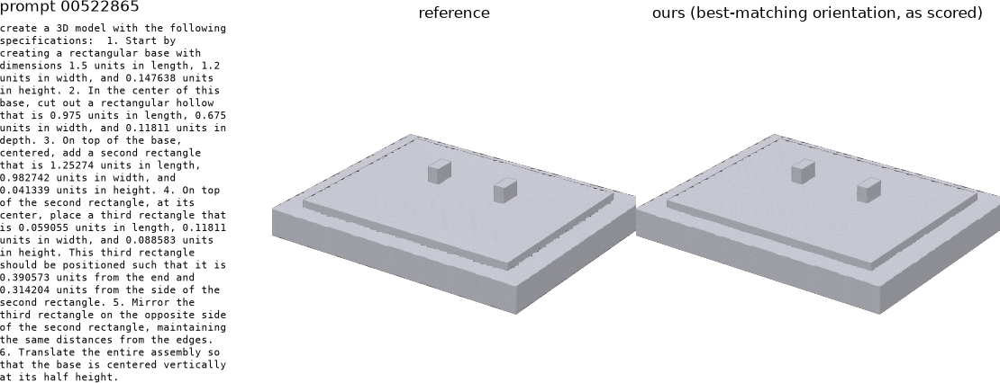
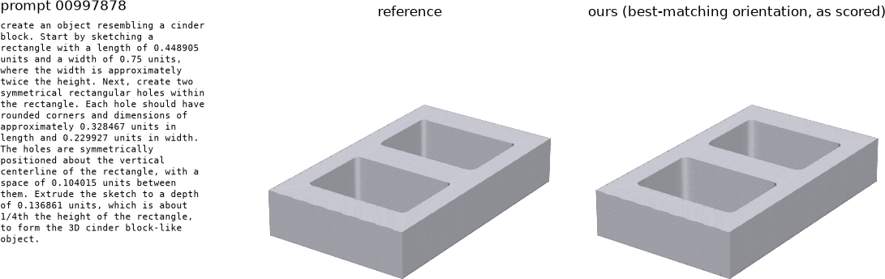
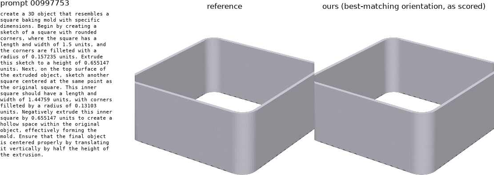
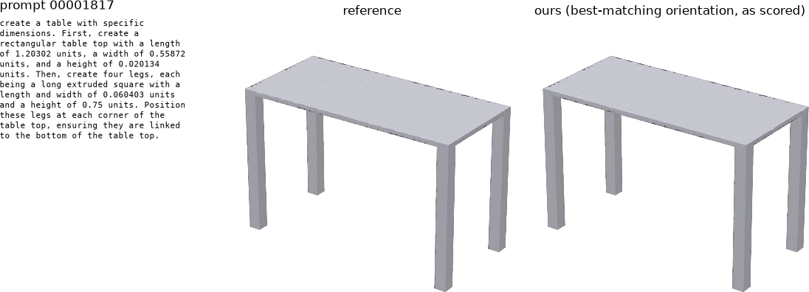
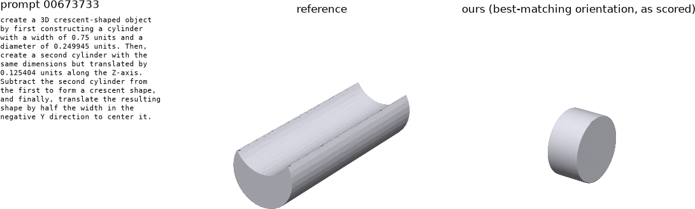

# cad-agent

A text-to-CadQuery agent for people who want a verified solid, not just code that runs: an LLM writes the part, a CadQuery kernel builds it, and a deterministic gate checks the measured geometry against the spec the model stated.

## Demo

Prompt, CADPrompt reference, and the agent's own output, rendered headlessly by `scripts/render_parts.py --compare` from `results/outputs` (the default-settings run, no model calls). "Ours" is drawn in the same best-of-24 axis rotation the pose-invariant scorer picked, at the same camera and scale. The first four are the most complex parts the default run got right that also look alike by eye after alignment (reference faces: 26, 22, 18, 18). Parts that scored well but visibly differ (e.g. 00853706 lacks the per-layer rotation, 00851553 misses the hollow) are left out. The last is an honest failure: the prompt's crescent became a full cylinder (chamfer 0.157).











## Quickstart

```
pip install cadquery trimesh scipy numpy pytest
export DEEPSEEK_API_KEY=...        # optional: DEEPSEEK_BASE_URL, CAD_MODEL; or point CAD_ENV at a dotenv file
python agent.py "a 40x20x10 mm block with two 5 mm through holes"
pytest tests                       # offline, no key needed
python scripts/bench_kernel.py /path/to/CADPrompt   # offline kernel timing
```

`CAD_PY` selects the interpreter that has CadQuery (default: the current one). `CAD_LOCAL` (mlx) and `CAD_CLI` (Claude Code CLI) switch the model backend. The CADPrompt scripts read `CADPROMPT_DIR`.

## How it works

1. The model returns a JSON spec (bbox, hole diameter:count, optional volume) and a CadQuery program.
2. `kernel.py` runs it in a persistent subprocess (CadQuery imports once, then about 10 ms per run) and measures validity, solid count, bbox, volume and holes.
3. `gate()` in `agent.py` passes only if there is exactly 1 valid solid, bbox within max(0.05 mm, 0.2%), identical hole diameter:count, and volume within 2% when given.
4. On failure the measured numbers go back to the model, up to 3 tries. Two candidates (temperature 0 and 0.8) race and the first to pass wins. If none passes, the last program that ran is kept as an unverified fallback and `ok` stays false.

## Results

All CADPrompt numbers are on the 200 items in `results/`, DeepSeek flash unless stated. Each number maps to a file in `results/INDEX.md`. Three paid full runs, one each. The fixes (error-specific retry hints, polygon and unit rules, one retry when a prompt number is missing from the code) are now the default; `CAD_NO_FIX1/2/3=1` turns each off.

| Run | Pose-invariant chamfer < 0.05 | Strict, no ICP | Gate pass | Median time | Cost |
|---|---|---|---|---|---|
| Baseline (no fixes) | 157/200 (78.5%) | 110 | 152 | 4.77 s | $0.23 |
| Fixes 2+3 | 161/200 (80.5%) | 117 | 147 | 3.51 s | $0.15 |
| Fixes 1+2+3 (default) | 162/200 (81.0%) | 121 | 147 | 3.68 s | $0.13 |

Files: `cadprompt_fresh*`, `cadprompt_fix23*`, `cadprompt_fix123*` in `results/`. Honest read: one run each, no repeats, so a few items of difference are within run-to-run noise (the earlier baseline run alone scored 151 against 157). Strict no-ICP went 110 to 121 (+10%); pose-invariant went 157 to 162 (+3.2% relative). Gate pass fell from 152 to 147. Cost differences also include API-side variation. The goal below is not met on pose-invariant accuracy: 1.5x fewer errors than 78.5% would be 85.7%.

| Metric | Ours | Published best | Goal (1.5x fewer errors) | Met |
|---|---|---|---|---|
| CADPrompt compile rate (earlier run) | 95.5% | 96.5% (CADCodeVerify, GPT-4 few-shot) [1] | 97.7% | no |
| CADPrompt median point-cloud distance (earlier run) | 0.036 (no ICP) | 0.127 (same row) [1] | 0.085 | yes, but see note |
| Median time per part (earlier run) | 3.83 s (p90 6.83 s) | not reported | none | n/a |
| Kernel metrics time per part (offline) | 6.58 ms, was 13.20 ms | not reported | none | 2.0x faster |

Note on distance: both normalise to a unit box and use chamfer-style distance, but the code is not the paper's. The published figure is a median of GPT-4 outputs with failures scored at the maximum; ours scores failures at 3*sqrt(3). Treat the comparison as indicative.

Other CADPrompt numbers: failure causes are in `results/failure_analysis.md`. Qwen3-30B-A3B local: 106/200 (53%). Qwen3-4B, not fine-tuned: 17/30.

Own 44-case suite (hand-written truth, one run):

| Model | Pass | Median | Tokens |
|---|---|---|---|
| deepseek flash | 41/44 | 2.05 s | 18,530 |
| deepseek v4 pro | 36/44 | 3.0 s | 23,482 |
| haiku 5.5 | 44/44 | 8.67 s | 47,615 |
| sonnet 5.5 | 44/44 | 8.86 s | 14,918 |
| opus 5.5 | 44/44 | 6.97 s | 11,478 |

Kernel speed: `scripts/bench_kernel.py` replays the 200 reference programs and takes the best-of-7 median of `kernel.metrics`: 13.20 ms before, 6.58 ms after (`Faces()` was called repeatedly; now once). A second before-run gave 13.95 ms. This is about 1% of end-to-end latency, which the LLM call dominates. The same change set fixes a crash on CadQuery 2.8 (17 of 200 reference parts raised in `metrics`).

Sources: [1] CADCodeVerify, Alrashedy et al., https://arxiv.org/abs/2410.05340 (Table 2, best-refine medians). Not comparable, different benchmark (Text2CAD test set, invalid ratio): CAD-Coder 98.55% valid, https://arxiv.org/abs/2505.19713; Text-to-CadQuery, https://arxiv.org/abs/2505.06507.

## Limits

- Accuracy needs a paid rerun to improve: a fresh CADPrompt-200 pass at about $0.002 per part is about $0.40 per candidate, about $0.80 with the race. No such run was done here, so no accuracy number changed.
- The gate checks bbox, holes and volume only; a wrong fillet or feature position with the same volume passes. A typed certificate to catch this scored AUC 0.542, below the pre-registered 0.65, so it is not used.
- The 44-case truth is hand-written. Earlier notes say the misses on suites A and B were wrong expected values; that was not re-run.
- A "fine-tuned 4B 41.5%" figure appears in earlier project notes. There is no evidence for it in this repo, so it is not claimed.
- Parts are prismatic and revolve shapes; no assemblies, threads or splines.
- The CadQuery fix was checked on 2.8.0 only. CI is not set up: CadQuery's OCP wheels are large and I could not run Actions here.

## License

MIT
